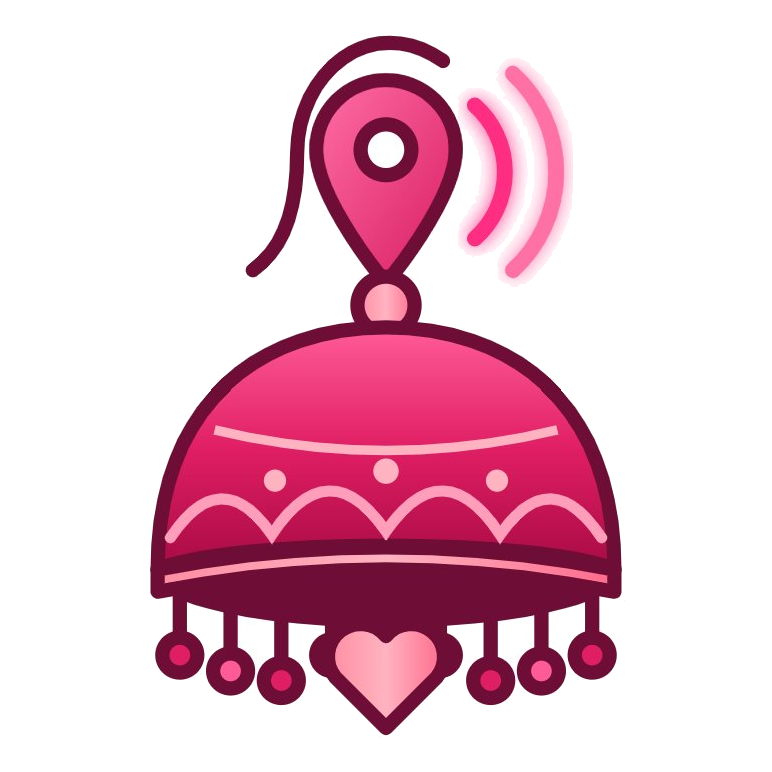

# Jhumka — Your Silent Guardian & Emergency Safety Network

<p align="center">
  
</p>

<p align="center">
  <strong>Personal Safety, Rapid SOS Escalation & Real-Time Guardian Network</strong>
</p>

<p align="center">
  <a href="https://kotlinlang.org"></a>
  <a href="https://developer.android.com/studio/releases/gradle-plugin"></a>
  <a href="https://developer.android.com/jetpack/compose"></a>
  <a href="https://developer.android.com"></a>
  <a href="https://developer.android.com"></a>
  <a href="LICENSE"></a>
</p>

---

**Jhumka** is a native Android personal safety and emergency SOS application engineered in **Kotlin** with **Jetpack Compose (Material 3)** following strict **Clean Architecture (Data / Domain / Presentation)**. 

Rooted in culturally resonant design—symbolized by the Indian traditional *Jhumka* earring transformed into an alert bell and safety beacon—the app provides life-critical reliability, multi-device guardian synchronization, real-time live GPS tracking, telecom fallback dispatch, and discrete emergency escape tools.

---

## 🌟 Highlights & Core Features

### 1. 2-Second Hold Tactile SOS Button
* **Accidental Trigger Prevention**: Requires an intentional 2-second continuous hold with real-time radial progress animations and haptic tick feedback.
* **Instant Emergency Dispatch**:
  - Wakes device and elevates process to high-priority Android Foreground Service (`START_STICKY`).
  - Activates high-decibel looping siren alarm on `STREAM_ALARM` (bypassing Silent / Do Not Disturb).
  - Starts continuous 5-second GPS telemetry writes to Google Firebase.
  - Begins background microphone audio evidence capture in AAC format.

### 2. Dual-Engine Live Tracking (Google Maps + OpenStreetMap)
* **Zero-Cost Instant OSM Fallback**: If a Google Maps API key is not present, Jhumka seamlessly falls back to OpenStreetMap tiles (`osmdroid`) with zero configuration or billing.
* **High-Contrast Google Maps Integration**: Dark JSON custom-styled vector map rendering live ward markers, dynamic accuracy radius halos, and movement trails.
* **1-Tap Interactive Provider Switch**: Seamless toggle button on the map overlay allows guardians to switch between Google Maps and OpenStreetMap in real-time.
* **Smart LRU Address Cache**: High-speed reverse-geocoding cache translating GPS coordinates to landmark and street names without rate-limiting.

### 3. Multi-Channel Emergency Escalation
* **Sequential Auto-Calling**: Automatically places a cellular call to the Priority #1 trusted contact. If unanswered or rejected after 10 seconds, telephony listeners escalate and dial Priority #2 automatically.
* **Multipart Location SMS Broadcast**: Offline failover dispatches formatted SMS text with a clickable Google Maps link (`https://maps.google.com/?q=lat,lng`) to **all** contacts in the user's emergency hierarchy simultaneously.
* **Quick Emergency Helpline Sheet**: 1-tap dial shortcuts for National Emergency (`112`), Women Helpline (`1091`), and Ambulance (`108`).

### 4. Zero-Cost Real-Time Guardian Network (Firebase)
* **6-Character Pairing Handshake**: Wards share a unique safety code (e.g. `SOS-46P87T`). Guardians enter the code to pair accounts.
* **Real-Time Synchronized Alarm**: When a ward triggers SOS, paired guardians' devices instantly ring with high-priority heads-up banners, siren audio, and a "Track on Map" shortcut.
* **Stale Session Purge & Safe Dismiss**: Automatically auto-resolves emergency sessions older than 30 minutes without active pings, and provides guardians with an instant "Dismiss / Safe" override.

### 5. Discrete Indian Fake Call Escape
* **Authentic Localized Presets**: Authentic caller profiles (`Mom`, `Police Inspector`, `Office HR`, `Cab Driver`, `Roommate`) with genuine phone number formats (`+91 98101 23456`) and carrier subtitles (`Calling via Jio 5G`, `Calling via Airtel 5G`).
* **Text-to-Speech (TTS) Conversation Engine**: Answers via realistic earpiece audio with conversational prompts giving users an immediate, convincing excuse to step away from uncomfortable or threatening environments.

### 6. Timed Walking Safety Check-In
* **Countdown Check-In**: Users can initiate a 5- to 60-minute safety timer when commuting or walking home alone.
* **PIN Guard**: If the countdown expires before the user enters their security PIN, Jhumka triggers full emergency SOS mode automatically.

---

## 🎨 Design System: Obsidian Noir & Clean Blush

Jhumka features dual-palette Material 3 theming with custom typography (**Poppins**):

| Mode | Theme Personality | Background | Surface / Cards | Primary Accent | Alert / Siren |
|---|---|---|---|---|---|
| **Dark Theme** | *Obsidian Noir* (High contrast, OLED battery-saver) | `#0B080B` | `#161118` | `#FF4D8D` (Jhumka Rose) | `#FF1744` (Alert Red) |
| **Light Theme** | *Clean Blush* (Soft rose, daytime readability) | `#FFF5F8` | `#FFFFFF` | `#E91E63` (Deep Pink) | `#D50000` (Signal Red) |

---

## 🏗️ Architecture & Project Structure

The project follows strict **Clean Architecture (Data / Domain / Presentation)** with zero third-party framework leaks in the UI layer:

```
app/src/main/java/com/womensafety/sos/
├── MainActivity.kt                      # Compose host & dynamic theme controller
├── WomenSafetyApp.kt                    # Application class (DI, notification channels, OSM setup)
├── data/
│   ├── entity/                          # Room SQLite entities (TrustedContact, IncidentLog, PairedWard)
│   ├── firebase/                        # FirebaseAuthManager & regional FirebaseDatabaseHelper
│   ├── local/                           # AppDatabase with SQLite migrations & DAOs
│   ├── location/                        # FusedLocationTracker & LRU Geocoder
│   ├── model/                           # EmergencyEvent & NotificationItem schemas
│   ├── pref/                            # UserPreferencesRepository (DataStore/Prefs)
│   ├── repository/                      # SafetyRepositoryImpl, EmergencyRepositoryImpl, NotificationRepositoryImpl
│   └── util/                            # PhoneUtils (10-digit validation), ContactImportHelper
├── di/
│   └── ServiceLocator.kt                # Dependency Injection container
├── domain/repository/                   # Domain interfaces (Safety, Emergency, Notification)
├── service/
│   ├── EmergencyForegroundService.kt    # Foreground service (GPS, siren, call escalation)
│   ├── AudioRecorderService.kt          # AAC microphone evidence recorder
│   ├── GuardianMonitorService.kt        # Guardian background RTDB/Firestore listener
│   ├── NotificationHelper.kt            # Channels, heads-up banners & alerts
│   └── SosTriggerHelper.kt              # Central emergency activation coordinator
└── ui/
    ├── adaptive/WindowInfo.kt           # Adaptive layout for phones and tablets
    ├── components/                      # SosButton, SafetyMap, OsmMap, TopBar, CallPanel
    ├── navigation/                      # Compose NavGraph & screen routing
    ├── screens/                         # Home, LiveTracking, FakeCall, Contacts, CheckIn, Settings, Login
    └── theme/                           # Color, Theme, Type (Poppins typography scale)
```

---

## 🔒 Backend Security Architecture

Jhumka uses a defense-in-depth security model across **Firebase Authentication**, **Cloud Firestore**, and **Realtime Database**:

1. **Authentication Gatekeeper**: Every device authenticates via Google Sign-In, Email, or an auto-provisioned **Anonymous Firebase Session** (`auth.signInAnonymously()`). Unauthenticated requests are blocked at the perimeter.
2. **Cloud Firestore Rules (`firestore.rules`)**:
   - `users/{uid}`: Public read for pairing code handshake; write strictly limited to the account owner (`request.auth.uid == uid`).
   - `notifications/{uid}/items`: Private per-user inbox isolation.
   - `pairs/` & `emergencies/`: Protected live tracking feeds restricted to authenticated network members.
3. **Realtime Database Rules (`database.rules.json`)**: Telemetry nodes under `guardians/$pairingCode` and `incidents/$incidentId` require authenticated tokens (`auth != null`).

---

## 🚀 Getting Started

### Prerequisites
* **Android Studio** Ladybug (2024.2.1) or newer
* **JDK 17** or **JDK 21**
* **Android SDK Platform 34 / 35**
* Physical device or emulator running **Android 8.0 (API 26)** or higher

### Installation & Run

1. **Clone the repository:**
   ```bash
   git clone https://github.com/gauravv00/women-safety.git
   cd women-safety
   ```

2. **Configure Local Properties:**
   Create or edit `local.properties` in the project root:
   ```properties
   sdk.dir=C:\\Users\\<YourUsername>\\AppData\\Local\\Android\\Sdk
   
   # Optional: Google Maps API key (leave empty to use OpenStreetMap free tiles)
   MAPS_API_KEY=
   ```

3. **Firebase Configuration:**
   Place your `google-services.json` inside the `app/` folder. Ensure **Anonymous Authentication** is enabled in the Firebase Console.

4. **Build and Run:**
   ```bash
   # Assemble debug APK
   ./gradlew assembleDebug

   # Install directly to attached device via ADB
   ./gradlew installDebug
   ```

---

## 📱 Testing Workflow: Guardian Pairing & Emergency SOS

1. **Phone A (Ward)**:
   - Go to **Settings** $\rightarrow$ copy unique 6-character code (e.g. `SOS-46P87T`).
2. **Phone B (Guardian)**:
   - Go to **Settings** $\rightarrow$ tap **+** in *Paired Wards* $\rightarrow$ enter Ward's code and nickname $\rightarrow$ submit.
3. **Phone A (Ward)**:
   - Bell icon shows unread badge $\rightarrow$ open **Notifications** $\rightarrow$ tap **Accept**.
4. **Trigger Emergency**:
   - Phone A holds **SOS for 2 seconds**.
   - Phone A sounds max-volume siren and begins dialing Priority #1 contact.
   - Phone B rings immediately with a heads-up alert banner $\rightarrow$ taps **Track on Map** to view Phone A's real-time GPS path.
5. **Resolution**:
   - Phone A holds SOS again (or Phone B taps **Dismiss / Safe**). Emergency clears and siren silences.

---

## 📄 Documentation

Comprehensive technical documentation covering every file, function, architecture diagram, and system service is available in:
* **Markdown**: [`docs/TECHNICAL_DOCUMENTATION.md`](docs/TECHNICAL_DOCUMENTATION.md)
* **Word Document**: [`docs/Women_Safety_Jhumka_Technical_Documentation.docx`](docs/Women_Safety_Jhumka_Technical_Documentation.docx)

---

## 📜 License

This project is licensed under the MIT License — see the [LICENSE](LICENSE) file for details.
