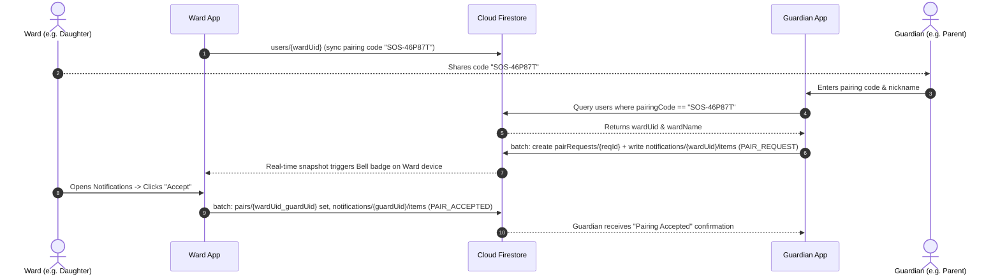
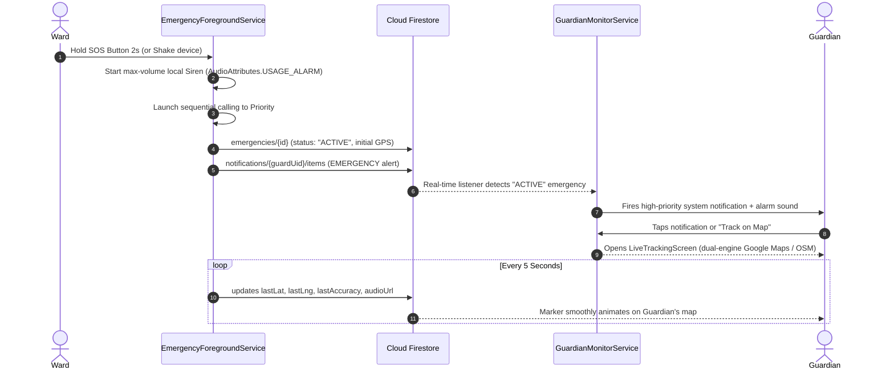
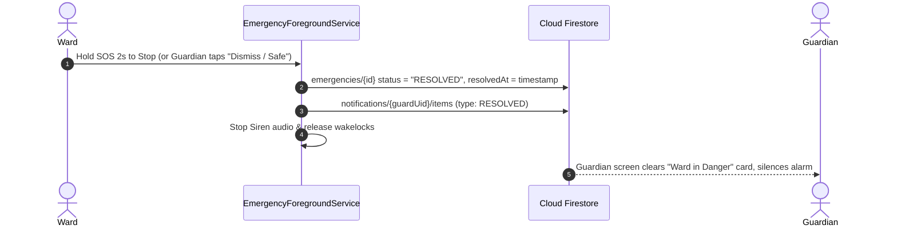

# Women Safety SOS (Jhumka) — Complete Technical Documentation

---

## 1. Executive Summary & Architecture Overview

The **Women Safety SOS** app (branded as **Jhumka**) is an offline-resilient, real-time safety network built for Android using **Kotlin**, **Jetpack Compose (Material 3)**, and **Google Firebase**. 

The app operates on a strict **Clean Architecture (Data / Domain / Presentation)** pattern:
* **Presentation (UI & ViewModels)**: Declarative Jetpack Compose screens consuming state flows; no direct Firebase or Room references.
* **Domain Layer (Repository Interfaces & Domain Models)**: High-level business contracts defining operations for safety, emergency tracking, and notifications.
* **Data Layer (Implementations, Local DB, Firebase, Sensors)**: Concrete repositories (`SafetyRepositoryImpl`, `EmergencyRepositoryImpl`, `NotificationRepositoryImpl`), Room Database, Android Location APIs, Accelerometer sensors, and Firebase (Auth, Firestore, Realtime Database, Cloud Storage).
* **Services**: Foreground services for continuous SOS tracking, emergency siren, sequential calling, and background monitoring.

---

## 2. Where Are the API Keys?

| Key / Config Item | Location in Codebase | Purpose & Protection |
|---|---|---|
| **Google Maps API Key** | `local.properties` (`MAPS_API_KEY=...`) & `app/build.gradle.kts` | Loaded dynamically via Gradle into `manifestPlaceholders["MAPS_API_KEY"]` and `BuildConfig.MAPS_API_KEY`. Kept out of version control via `.gitignore`. If empty, the app seamlessly falls back to OpenStreetMap (`OsmMap.kt`). |
| **Firebase Web API Key** | `app/google-services.json` (`client[0].api_key[0].current_key`) | Used by the Firebase Android SDK to communicate with Firebase Auth, Cloud Firestore, and RTDB for project `wosafety-17b7e`. |
| **Firebase OAuth Client ID** | `app/google-services.json` (`oauth_client[0].client_id`) & `LoginViewModel.kt` | Used by Google Identity Services (Credential Manager) for single-tap Google Sign-In. Bound to SHA-1 signature `ee:30:6d:fc:19:4a:e7:36:3d:c6:df:87:63:80:1c:74:70:92:e3:e1`. |
| **Firebase Realtime DB URL** | `app/google-services.json` (`project_info.firebase_url`) & `FirebaseDatabaseHelper.kt` | Points explicitly to `https://wosafety-17b7e-default-rtdb.asia-southeast1.firebasedatabase.app` (Singapore region). |
| **Firebase Storage Bucket** | `app/google-services.json` (`project_info.storage_bucket`) & `SafetyRepositoryImpl.kt` | Targets `gs://wosafety-17b7e.firebasestorage.app` for audio incident evidence. |

---

## 3. How the Backend is Secure

The backend uses a defense-in-depth model combining **Firebase Authentication**, **Cloud Firestore Rules**, **Realtime Database Security Rules**, and **Cloud Storage Rules**.

### A. Authentication Gatekeeper (`FirebaseAuthManager`)
No client can read or write to Firebase without an authenticated session.
- If a user doesn't sign in via Google or Phone OTP, the app automatically establishes an **Anonymous Firebase Authentication session** (`auth.signInAnonymously()`).
- This produces a unique, tamper-proof `request.auth.uid`.

### B. Cloud Firestore Security Rules (`firestore.rules`)
```javascript
rules_version = '2';
service cloud.firestore {
  match /databases/{database}/documents {

    // 1. User Profiles: Any authenticated user can look up pairing codes; only owner can edit profile.
    match /users/{uid} {
      allow read: if request.auth != null;
      allow write: if request.auth != null && request.auth.uid == uid;
    }

    // 2. Notifications Inbox: Only inbox recipient can read/mark read/delete. Any signed-in user can send alerts.
    match /notifications/{uid}/items/{notifId} {
      allow read, update, delete: if request.auth != null && request.auth.uid == uid;
      allow create: if request.auth != null;
    }

    // 3. Pairing Requests: Both guardian and ward can read and update handshake requests.
    match /pairRequests/{requestId} {
      allow read, write: if request.auth != null;
    }

    // 4. Active Pairs: Only authenticated users in the network can read/write pair links.
    match /pairs/{pairId} {
      allow read, write: if request.auth != null;
    }

    // 5. Emergency SOS Records: Authenticated guardians & wards can broadcast and track live telemetry.
    match /emergencies/{emergencyId} {
      allow read, write: if request.auth != null;
      match /{sub=**} {
        allow read, write: if request.auth != null;
      }
    }
  }
}
```

### C. Realtime Database Security Rules (`database.rules.json`)
```json
{
  "rules": {
    "guardians": {
      "$pairingCode": {
        ".read": "auth != null",
        ".write": "auth != null"
      }
    },
    "incidents": {
      "$incidentId": {
        ".read": "auth != null",
        ".write": "auth != null"
      }
    }
  }
}
```
* Restricts access so only authenticated clients can read or publish live emergency GPS coords under their specific pairing code or incident ID.

### D. Audio Evidence Storage Rules (`storage.rules`)
```javascript
rules_version = '2';
service firebase.storage {
  match /b/{bucket}/o {
    match /audio_evidence/{allPaths=**} {
      allow read, write: if request.auth != null;
    }
  }
}
```
* Prevents unauthenticated public internet scraping of audio evidence recordings.

---

## 4. End-to-End App Flows

### Flow 1: Device Pairing Handshake (Ward & Guardian)


### Flow 2: Emergency SOS Trigger, Live Tracking & Siren


### Flow 3: Safe Resolution Flow


---

## 5. Android System Services, Background Processing & Kotlin Coroutines Architecture

This project is built from the ground up to guarantee 100% reliability during life-critical emergencies. It leverages native Android framework services, hardware access layers, foreground lifecycles, and asynchronous Kotlin Coroutines.

---

### A. Android Framework System Services Used

| System Service / Manager | Implementation Class | Life-Safety Purpose & Technical Operation |
|---|---|---|
| **`FusedLocationProviderClient` / `LocationManager`** | `LocationTracker.kt`, `EmergencyForegroundService.kt` | Requests high-accuracy GPS (`PRIORITY_HIGH_ACCURACY`) every 5000ms with a 2000ms fastest interval. Bypasses Android battery-saver throttling during active emergency sessions using foreground service elevation. |
| **`TelecomManager` / `TelephonyManager`** | `EmergencyForegroundService.kt` | Initiates automated cellular phone calls (`TelecomManager.placeCall()`). Implements `TelephonyCallback.CallStateListener` (Android 12+) and `PhoneStateListener` (legacy) to detect call states: `CALL_STATE_RINGING`, `CALL_STATE_OFFHOOK` (answered), and `CALL_STATE_IDLE` (call ended/rejected) for sequential escalation. |
| **`SmsManager`** | `SafetyRepositoryImpl.kt` | Offline failover mechanism. If internet is completely unavailable or Firestore times out, `SmsManager.getDefault().sendTextMessage()` dispatches an emergency SMS containing the live Google Maps coordinates link directly to all trusted contacts. |
| **`PowerManager` (`WakeLock`)** | `EmergencyForegroundService.kt` | Acquires a `PowerManager.PARTIAL_WAKE_LOCK` tagged as `"womensafety:sos_wakelock"`. Keeps the device CPU awake, preventing Android Doze mode and App Standby from killing GPS telemetry and audio recording while the phone is locked or screen is off. |
| **`AudioManager`** | `EmergencyForegroundService.kt` | Configures audio streams for emergency alert playback. Routes siren alarm to `AudioAttributes.USAGE_ALARM` / `STREAM_ALARM`, temporarily raising stream volume to maximum (100%) so that silent or Do-Not-Disturb modes do not silence the siren. |
| **`NotificationManager` & Channels** | `NotificationHelper.kt` | Manages 3 distinct system channels: `emergency_channel` (Importance: `HIGH`, custom vibration `[0, 500, 200, 500]`, bypasses DND), `guardian_channel` (Importance: `DEFAULT`), and `general_channel`. Posts ongoing foreground notifications with embedded action PendingIntents ("Track on Map", "Stop SOS"). |
| **`MediaRecorder`** | `AudioRecorderService.kt` | Captures high-fidelity ambient microphone evidence in AAC (`AUDIO_ENCODER_AAC`) inside an MPEG-4 container (`OUTPUT_FORMAT_MPEG_4`) at 44.1 kHz sampling rate. Files are saved directly to sandboxed app cache storage and dispatched to Firebase Storage. |
| **`MediaPlayer`** | `EmergencyForegroundService.kt` | Low-latency audio playback for the looping alarm siren. Bound to `AudioAttributes.Builder().setUsage(AudioAttributes.USAGE_ALARM).build()`. |
| **`TextToSpeech` (TTS)** | `FakeCallViewModel.kt` | Synthesizes dynamic realistic voice responses during fake escape calls. Sets pitch and speech rate, outputs sound directly to `AudioAttributes.USAGE_VOICE_COMMUNICATION` (earpiece/receiver) to simulate an authentic two-way phone conversation. |
| **`Vibrator` / `VibratorManager`** | `SosButton.kt` | Generates haptic tick feedback (`VibrationEffect.createPredefined(EFFECT_TICK)`) as the user holds the SOS button, culminating in an assertive double-buzz when the 2-second threshold is reached. |
| **`Geocoder`** | `LocationAddressHelper.kt` | Translates live raw GPS latitude and longitude into physical street addresses and landmarks. Employs a thread-safe `LruCache` to avoid network rate-limiting. |

---

### B. Android Foreground Service & Background Execution Model

Modern Android (Android 10 through Android 14+) strictly terminates background processes to conserve battery. The app satisfies all Android 14 (API 34) Foreground Service type policies:

1. **`EmergencyForegroundService` (`Service.startForeground`)**:
   * Declared in `AndroidManifest.xml` with multiple foreground service types:
     `android:foregroundServiceType="location|microphone|phoneCall"`
   * Bound with `START_STICKY`, guaranteeing that if the operating system kills the service under extreme RAM pressure, the OS restarts the service as soon as resources become available.
   * Maintains an ongoing, un-swipeable system notification showing elapsed SOS time and a "STOP SOS" button.

2. **`GuardianMonitorService`**:
   * Runs in the background on guardian devices, listening to Firebase Realtime Database child nodes (`guardians/{pairingCode}`) and Firestore collection listeners.
   * Fires a full heads-up notification and audio alarm on the guardian's phone immediately when a ward enters `status: "ACTIVE"`.

3. **`AppFirebaseMessagingService` (`FirebaseMessagingService`)**:
   * Handles cloud-to-device push events when the app is completely closed or killed.
   * High-priority data payloads instantly wake the app process to present emergency alerts.

---

### C. Kotlin Coroutines & Reactive Concurrency Architecture

The application avoids thread blocking and memory leaks through structured concurrency:

#### 1. Coroutine Dispatchers Separation
* **`Dispatchers.IO`**: Exclusively used for disk reads/writes (Room SQLite DB operations), network communication (Firestore queries, RTDB synchronization, Cloud Storage media uploads), Geocoder lookups, and file operations.
* **`Dispatchers.Main`**: Drives UI rendering, Jetpack Compose recomposition triggers, and ViewModels emitting state to Compose.
* **`Dispatchers.Default`**: Handles CPU-intensive tasks such as contact list sorting, data deduplication, and mathematical coordinate calculations.

#### 2. Coroutine Scopes & Structured Lifecycles
* **`viewModelScope`**: Tied to ViewModel lifecycles (`HomeScreen`, `EmergencyViewModel`, `LiveTrackingViewModel`). Automatically cancels active asynchronous tasks when the user navigates away from a screen, eliminating coroutine leaks.
* **Service Coroutine Scope**: In `EmergencyForegroundService`, a custom scope is constructed:
  ```kotlin
  private val serviceScope = CoroutineScope(SupervisorJob() + Dispatchers.IO)
  ```
  `SupervisorJob` ensures that if one background task fails (e.g., a single location upload network timeout), sibling tasks (such as audio recording or calling) continue running uninterrupted.
* **`ServiceLocator` / Singleton Scope**: Used in `FirebaseAuthManager` for background profile synchronization and token refresh without tying execution to an Activity.

#### 3. Reactive Streams with `StateFlow` and `SharedFlow`
* **`StateFlow<T>`**: Emits current state to Compose composables (e.g. `isEmergencyActive`, `contacts`, `unreadCount`).
* **`stateIn` with `SharingStarted.WhileSubscribed(5000)`**: Ensures Firestore real-time listeners are only active while at least one UI composable is observing them, cleanly shutting down network subscriptions 5 seconds after the screen enters background.

#### 4. Asynchronous Callback Bridging via `callbackFlow`
Many native Android APIs (Firestore listeners, RTDB `ValueEventListener`, Phone State listeners) use event callbacks rather than suspending functions. The app converts these into reactive Kotlin Flows using `callbackFlow` and `awaitClose`:
```kotlin
override fun observeActiveEmergencies(): Flow<List<EmergencyEvent>> = callbackFlow {
    val listener = firestore.collection("emergencies")
        .whereIn("wardUid", chunks)
        .whereEqualTo("status", "ACTIVE")
        .addSnapshotListener { snapshot, error ->
            if (error != null) return@addSnapshotListener
            val events = snapshot?.documents?.mapNotNull { /* transform */ } ?: emptyList()
            trySend(events)
        }
    awaitClose {
        listener.remove() // Clean up listener when collector cancels
    }
}
```

#### 5. Google Play Services Task Interop (`tasks.await()`)
* Through `kotlinx-coroutines-play-services`, callback-based `Task<T>` objects from Firebase (e.g. `auth.signInAnonymously().await()`, `document.set().await()`, `storageRef.downloadUrl.await()`) and Google Location APIs are transformed into clean, sequential, suspendable calls without callback nesting.

---

## 6. Directory Breakdown & File Index

```
app/src/main/java/com/womensafety/sos/
├── MainActivity.kt                      # Root Android Activity & Compose entry point
├── WomenSafetyApp.kt                    # Application class (DI, notification channels, OSM config)
├── data/
│   ├── entity/                          # Room database entities
│   │   ├── IncidentLog.kt               # Local record of past SOS incidents
│   │   ├── PairedWard.kt                # Local cache of paired wards
│   │   └── TrustedContact.kt            # Emergency contacts (name, phone, priority)
│   ├── firebase/                        # Firebase helpers & singletons
│   │   ├── FirebaseAuthManager.kt       # Anonymous & social auth manager
│   │   └── FirebaseDatabaseHelper.kt    # Regional RTDB instance provider (Singapore)
│   ├── local/                           # SQLite Room Database
│   │   ├── AppDatabase.kt               # Room database definition with migrations
│   │   └── dao/                         # Data Access Objects (Incident, Ward, Contact)
│   ├── location/                        # Geolocation & geocoding
│   │   ├── LocationAddressHelper.kt     # Android Geocoder reverse-geocoding
│   │   └── LocationTracker.kt           # FusedLocationProviderClient wrapper
│   ├── model/                           # Cross-network domain data models
│   │   ├── EmergencyEvent.kt            # Live SOS session schema
│   │   └── NotificationItem.kt          # User inbox notification schema
│   ├── pref/                            # SharedPreferences & settings
│   │   └── UserPreferencesRepository.kt # App preferences (dark mode, siren, PIN, codes)
│   ├── repository/                      # Concrete repository implementations
│   │   ├── EmergencyRepositoryImpl.kt   # Firestore emergency broadcasting & auto-cleanup
│   │   ├── NotificationRepositoryImpl.kt# Pairing handshakes & in-app inbox
│   │   └── SafetyRepositoryImpl.kt      # SMS dispatch, audio upload, Room incident logging
│   └── util/                            # Utility helpers
│       ├── ContactImportHelper.kt       # Device contacts content-resolver picker
│       └── PhoneUtils.kt                # E.164 phone sanitizer & 10-digit validation
├── di/
│   └── ServiceLocator.kt                # Dependency injection container
├── domain/repository/                   # Pure domain contracts
│   ├── EmergencyRepository.kt
│   ├── NotificationRepository.kt
│   └── SafetyRepository.kt
├── service/                             # Android background & foreground services
│   ├── AppFirebaseMessagingService.kt   # FCM push notification receiver
│   ├── AudioRecorderService.kt          # High-fidelity AAC microphone evidence recorder
│   ├── EmergencyForegroundService.kt    # Sticky foreground service running active SOS
│   ├── EmergencySosService.kt           # Secondary GPS/Firestore sync service
│   ├── GuardianMonitorService.kt        # Background poll/listener for guardian alerts
│   ├── NotificationHelper.kt            # Android notification manager (channels, alerts)
│   └── SosTriggerHelper.kt              # Central coordinator to trigger or cancel SOS
└── ui/
    ├── adaptive/WindowInfo.kt           # Responsive window size classes (phone/tablet/landscape)
    ├── components/                      # Reusable Compose widgets
    │   ├── EmergencyCallPanel.kt        # Direct dial keypad & police shortcuts
    │   ├── JhumkaWatermarkBackground.kt # Artistic mandala watermark branding
    │   ├── OsmMap.kt                    # OpenStreetMap (osmdroid) fallback map
    │   ├── SafetyMap.kt                 # Google Maps with dual-engine toggle
    │   ├── SosButton.kt                 # Glowing 2-second hold SOS trigger button
    │   └── TopBar.kt                    # Top app bar with logo, greeting, and notification bell
    ├── navigation/                      # Screen routing & arguments
    │   ├── NavGraph.kt                  # Compose navigation graph
    │   └── Screen.kt                    # Route sealed class
    ├── screens/                         # Feature screens & ViewModels
    │   ├── checkin/                     # Timed safety walking check-in
    │   ├── contacts/                    # Trusted contact manager with priority order
    │   ├── fakecall/                    # Realistic Indian fake caller simulator
    │   ├── home/                        # Main SOS dashboard
    │   ├── login/                       # Google & Email authentication flow
    │   ├── logs/                        # History of past SOS events
    │   ├── map/                         # Live real-time GPS tracking screen
    │   ├── notifications/               # In-app inbox & pair request approvals
    │   └── settings/                    # Preferences, pairing code sharing, dark mode
    └── theme/                           # Design system (Color, Type, Theme)
```

---

## 7. Detailed File-by-File Code Rundown

### A. Root Application & Entry Points

#### 1. `MainActivity.kt`
* **Purpose**: Single-activity host for Jetpack Compose UI. Sets up hardware window insets, edge-to-edge layout, dynamic theme switching, and root navigation.
* **Key Functions**:
  * `onCreate()`: Initializes edge-to-edge, checks for incoming intents (e.g., notification clicks carrying `emergencyId`), and invokes `NavGraph`.
  * `setContent()`: Wraps the app in `WomenSafetyTheme(darkTheme = isDarkMode)` reading state from `UserPreferencesRepository`.

#### 2. `WomenSafetyApp.kt`
* **Purpose**: Subclasses `android.app.Application`. Starts application-wide singletons before any UI renders.
* **Key Functions**:
  * `onCreate()`:
    1. Initializes `ServiceLocator.init(this)`.
    2. Calls `NotificationHelper.createNotificationChannels(this)` to ensure system notification channels exist (`emergency_channel`, `guardian_channel`, etc.).
    3. Configures OpenStreetMap user-agent to prevent map tile 403 blocks (`Configuration.getInstance().userAgentValue = packageName`).

---

### B. Dependency Injection & State Management

#### 3. `di/ServiceLocator.kt`
* **Purpose**: Lightweight, zero-reflection Dependency Injection container providing singletons across the app.
* **Key Properties / Functions**:
  * `init(context)`: Builds the local Room database, instantiates `FirebaseAuthManager`, `UserPreferencesRepository`, and concrete repositories.
  * `safetyRepository`: Returns singleton `SafetyRepositoryImpl`.
  * `emergencyRepository`: Returns singleton `EmergencyRepositoryImpl`.
  * `notificationRepository`: Returns singleton `NotificationRepositoryImpl`.
  * `authManager`: Returns singleton `FirebaseAuthManager`.

---

### C. Data Layer: Firebase & Authentication

#### 4. `data/firebase/FirebaseAuthManager.kt`
* **Purpose**: Manages anonymous sessions, Google tokens, FCM token synchronization, and Firestore profile writes.
* **Key Functions**:
  * `ensureAuthenticated(): String`: Returns existing `currentUser.uid`. If null, calls `auth.signInAnonymously()` to guarantee an authenticated UID before any database write.
  * `syncUserDocument()`: Writes `displayName`, `pairingCode`, and `lastSeen` into `users/{uid}` in Firestore.
  * `syncFcmToken()` / `updateFcmToken(token)`: Updates device FCM push token in `users/{uid}/fcmToken`.

#### 5. `data/firebase/FirebaseDatabaseHelper.kt`
* **Purpose**: Factory providing configured Realtime Database instances with the Singapore regional URL.
* **Key Functions**:
  * `getInstance()`: Calls `FirebaseDatabase.getInstance("https://wosafety-17b7e-default-rtdb.asia-southeast1.firebasedatabase.app")`.

---

### D. Data Layer: Local Room Database & Preferences

#### 6. `data/local/AppDatabase.kt`
* **Purpose**: SQLite Room database holding local cached entities (`TrustedContact`, `IncidentLog`, `PairedWard`).
* **Key Functions**:
  * `contactDao()`: Accessor for contact queries.
  * `incidentDao()`: Accessor for SOS incident logs.
  * `pairedWardDao()`: Accessor for paired wards cached locally.
  * `MIGRATION_1_2`: Database migration handling schema upgrades.

#### 7. `data/local/dao/TrustedContactDao.kt`
* **Purpose**: CRUD operations on trusted emergency contacts.
* **Key Functions**:
  * `getAllContacts()`: Returns `Flow<List<TrustedContact>>` ordered by `priority ASC`.
  * `insertContact(contact)`: Inserts contact.
  * `deleteContact(contact)`: Deletes contact.
  * `updatePriority(id, priority)`: Re-indexes calling order.

#### 8. `data/local/dao/IncidentLogDao.kt`
* **Purpose**: CRUD operations on SOS incident history.
* **Key Functions**:
  * `insert(incident)`: Logs new emergency event with start time and location.
  * `resolveIncident(id, resolvedAt)`: Updates incident status to resolved.
  * `updateAudioCloudUrl(id, url)`: Attaches Cloud Storage audio evidence link.
  * `getActiveIncident()`: Queries whether an unresolved incident exists in SQLite.

#### 9. `data/local/dao/PairedWardDao.kt`
* **Purpose**: Local cache of wards being monitored by this device.
* **Key Functions**:
  * `getAllWards()`: Observes cached list of wards.
  * `insertWard(ward)` / `deleteByPairingCode(code)`: Updates ward relationships.

#### 10. `data/pref/UserPreferencesRepository.kt`
* **Purpose**: Encapsulates `SharedPreferences` (`women_safety_prefs`) with Kotlin `StateFlow`.
* **Key Functions**:
  * `saveDisplayName(name)`: Updates user name.
  * `setDarkMode(enabled)`: Toggles Obsidian Noir vs. Clean Blush theme.
  * `setSirenEnabled(enabled)`: Toggles audio siren during SOS.
  * `generatePairingCode()`: Generates random alphanumeric 6-character code (`SOS-XXXXXX`).
  * `setAutoCallDelay(seconds)`: Sets countdown seconds before auto-dialing.

---

### E. Data Layer: Location & Utils

#### 11. `data/location/LocationTracker.kt`
* **Purpose**: High-accuracy GPS location retrieval using Google Play Services `FusedLocationProviderClient`.
* **Key Functions**:
  * `getCurrentLocation()`: Suspends and retrieves high-accuracy fresh GPS coordinates (with timeout fallback to last known location).
  * `getLastLocation()`: Fast retrieval of cached location.

#### 12. `data/location/LocationAddressHelper.kt`
* **Purpose**: Converts latitude and longitude into human-readable street addresses and landmarks.
* **Key Functions**:
  * `resolveAddress(lat, lng)`: Queries Android `Geocoder` with an in-memory LRU cache to prevent rate-limiting and battery drain.

#### 13. `data/util/PhoneUtils.kt`
* **Purpose**: Sanitizes and validates phone numbers.
* **Key Functions**:
  * `sanitizePhoneNumber(raw)`: Strips spaces, parentheses, hyphens, preserving optional `+`.
  * `isValidPhoneNumber(phone)`: Enforces valid 10-digit mobile numbers or 12-digit Indian numbers (`+91`).
  * `formatForDisplay(raw)`: Formats numbers as `+91 XXXXX XXXXX`.

#### 14. `data/util/ContactImportHelper.kt`
* **Purpose**: Safe contact picker extracting phone numbers from `content://contacts` URIs.
* **Key Functions**:
  * `resolveContact(context, uri, existingNumbers)`: Extracts displayName and mobile number from `ContactsContract.CommonDataKinds.Phone`, handling multiple numbers and deduplication.

---

### F. Data Layer: Repositories

#### 15. `data/repository/SafetyRepositoryImpl.kt`
* **Purpose**: Coordinates local incident logging, SMS fallback dispatch, audio evidence uploading, and RTDB broadcasts.
* **Key Functions**:
  * `startEmergencySession(lat, lng)`: Creates an `IncidentLog` row in SQLite.
  * `broadcastSosToGuardians(...)`: Writes telemetry to Firebase RTDB `guardians/{pairingCode}`.
  * `uploadAudioEvidence(incidentId, path)`: Uploads microphone recording to Firebase Cloud Storage bucket `gs://wosafety-17b7e.firebasestorage.app` and saves URL to Room & Firestore.
  * `sendEmergencySmsToContacts(...)`: Dispatches SMS via `SmsManager` with Google Maps GPS link to all trusted contacts.

#### 16. `data/repository/EmergencyRepositoryImpl.kt`
* **Purpose**: Manages Cloud Firestore `emergencies/` documents, guardian multi-device listening, and stale auto-resolution.
* **Key Functions**:
  * `startEmergency(wardName)`: Creates new document in `emergencies/{id}` and fans out notifications to all paired guardians.
  * `updateLocation(id, lat, lng, accuracy)`: Updates current telemetry in `emergencies/{id}` every 5 seconds.
  * `resolveEmergency(id)`: Sets `status = "RESOLVED"` in Firestore and sends resolution notification to guardians.
  * `observeActiveEmergencies()`: Returns `Flow<List<EmergencyEvent>>` of all active wards monitored by this user. Automatically auto-resolves and purges stale emergency sessions older than 30 minutes with no location pings.

#### 17. `data/repository/NotificationRepositoryImpl.kt`
* **Purpose**: Manages in-app notifications (`notifications/{uid}/items`) and pair handshakes (`pairRequests/`, `pairs/`).
* **Key Functions**:
  * `getNotifications()`: Listens in real-time to user's notification inbox ordered by `createdAt DESC`.
  * `sendPairRequest(code, name)`: Looks up ward by pairing code, creates `pairRequests/` document, and posts `PAIR_REQUEST` card to ward's inbox.
  * `respondToPairRequest(notif, accept)`: If accepted, creates `pairs/{wardUid_guardianUid}` document, sends confirmation notification, and cleans request.
  * `unpair(wardUid, wardName)`: Deletes `pairs/` document.

---

### G. Background Services

#### 18. `service/EmergencyForegroundService.kt`
* **Purpose**: Sticky foreground service (`startForeground`) ensuring the SOS broadcast stays alive even if the app is swiped away or screen turns off.
* **Key Functions**:
  * `onStartCommand()`: Starts high-priority notification with "Stop SOS" action button.
  * `startLocationTracking()`: Schedules continuous 5-second GPS updates via `FusedLocationProviderClient`.
  * `startSiren()` / `stopSiren()`: Plays looping max-volume alarm audio on `STREAM_ALARM`.
  * `startSequentialEscalation()`: Dials Priority #1 contact; monitors `TelephonyCallback` / `PhoneStateListener` to automatically dial Priority #2 if call drops or is unanswered after 10 seconds.
  * `stopSelf()`: Releases GPS listeners, MediaPlayer, and Wakelocks.

#### 19. `service/AudioRecorderService.kt`
* **Purpose**: Background audio recorder capturing ambient microphone evidence during an incident.
* **Key Functions**:
  * `startRecording(incidentId)`: Initializes `MediaRecorder` targeting `.m4a` (AAC) format in application storage.
  * `stopRecording()`: Finalizes file and passes path to `SafetyRepository.uploadAudioEvidence()`.

#### 20. `service/GuardianMonitorService.kt`
* **Purpose**: Standalone background service for guardians to poll/listen to Realtime Database & Firestore for ward SOS alerts while the app is in the background.
* **Key Functions**:
  * `onStartCommand()`: Attaches value listeners to paired ward codes in RTDB.
  * Triggers system heads-up alert via `NotificationHelper` when ward status switches to `EMERGENCY`.

#### 21. `service/NotificationHelper.kt`
* **Purpose**: System notification builder managing channels, vibration patterns, full-screen intents, and badges.
* **Key Functions**:
  * `createNotificationChannels(context)`: Registers `emergency_channel` (max priority), `guardian_channel`, and `general_channel`.
  * `showEmergencyNotification(...)`: Posts high-importance heads-up alert with "Track on Map" action.
  * `cancelEmergencyNotification(id)` / `cancelAllAlerts()`: Dismisses active alert sounds.

#### 22. `service/SosTriggerHelper.kt`
* **Purpose**: Centralized trigger coordinator invoked by the UI SOS button.
* **Key Functions**:
  * `triggerSos(context, source)`: Starts `EmergencyForegroundService`, starts `AudioRecorderService`, writes to Firestore, and notifies guardians.
  * `cancelSos(context)`: Stops services, updates status to `RESOLVED`, and silences siren.

---

### H. Presentation Layer: Components & Navigation

#### 23. `ui/navigation/NavGraph.kt` & `Screen.kt`
* **Purpose**: Declarative Compose navigation graph mapping routes (`home`, `contacts`, `tracking/{emergencyId}`, `settings`, `logs`, `fakecall`, `checkin`, `login`, `notifications`).

#### 24. `ui/components/SosButton.kt`
* **Purpose**: The signature glowing SOS button. Requires a 2-second continuous press-and-hold to trigger (with animated circular progress stroke and haptic feedback) to prevent accidental pocket presses.

#### 25. `ui/components/SafetyMap.kt` & `OsmMap.kt`
* **Purpose**: Dual-engine live mapping component.
* **Key Features**:
  * Displays ward marker, accuracy radius circle, and guardian position.
  * Has a 1-tap provider toggle button: seamlessly switches between **Google Maps** and **OpenStreetMap (osmdroid)**.

#### 26. `ui/components/TopBar.kt`
* **Purpose**: Standard header displaying the custom **Jhumka** logo, personalized greeting (*"Hi, {Name}"*), and bell icon with animated unread count badge.

#### 27. `ui/components/EmergencyCallPanel.kt`
* **Purpose**: Bottom sheet slide-up panel with 1-tap emergency dial buttons (Police 112, Women Helpline 1091, Ambulance 108).

---

### I. Presentation Layer: Feature Screens & ViewModels

#### 28. `ui/screens/home/HomeScreen.kt` & `HomeViewModel.kt`
* **Purpose**: Primary dashboard containing the central SOS button, active emergency alert card, guardian status capsule, quick action grid, and background watermark.

#### 29. `ui/screens/home/EmergencyViewModel.kt`
* **Purpose**: State holder for live SOS sessions.
* **Key Functions**:
  * `startEmergency()`: Triggers SOS via repository.
  * `stopEmergency()`: Cancels SOS and marks emergency as resolved.
  * `dismissWardEmergency(id)`: Allows guardian to clear false/stale alert cards and mark ward safe in Firestore.

#### 30. `ui/screens/map/LiveTrackingScreen.kt` & `LiveTrackingViewModel.kt`
* **Purpose**: Dedicated real-time tracking screen displaying live GPS trail, ward battery status, distance calculation, call ward shortcut, and audio evidence playback player.

#### 31. `ui/screens/contacts/TrustedContactsScreen.kt` & `TrustedContactsViewModel.kt`
* **Purpose**: Management screen for priority emergency contacts. Supports adding manually (with strict 10-digit validation), picking from Android contacts, reordering priorities, and deleting.

#### 32. `ui/screens/notifications/NotificationsScreen.kt` & `NotificationViewModel.kt`
* **Purpose**: In-app inbox displaying pair requests and emergency alerts. Provides Accept/Decline action buttons with instant Firestore batch updates.

#### 33. `ui/screens/settings/SettingsScreen.kt` & `SettingsViewModel.kt`
* **Purpose**: User configuration screen. Allows viewing & copying 6-character safety pairing code, pairing a new ward, unpairing wards, toggling Dark Mode, configuring siren volume, and setting auto-call delay.

#### 34. `ui/screens/fakecall/FakeCallScreen.kt` & `FakeCallViewModel.kt`
* **Purpose**: Realistic incoming call simulator designed to give users a discreet excuse to escape uncomfortable or dangerous situations.
* **Key Features**:
  * Authentic Android phone dialer UI.
  * Localized presets (Police Inspector, Mom, Boss, Roommate).
  * Text-To-Speech (TTS) synthesized conversation voice that speaks through the ear speaker when the user answers.

#### 35. `ui/screens/checkin/SafetyCheckInScreen.kt` & `SafetyCheckInViewModel.kt`
* **Purpose**: Timed walking safety check-in countdown.
* **Key Features**:
  * User starts a 5–60 minute timer (e.g. while walking through a dark street or taking a cab).
  * If the user fails to check in with their PIN before the countdown expires, the app automatically triggers full SOS.

#### 36. `ui/screens/login/LoginScreen.kt` & `LoginViewModel.kt`
* **Purpose**: Multi-step onboarding and login screen. Supports Google Credential Manager One-Tap Sign In, Email/Password login, and Anonymous guest skip.

#### 37. `ui/screens/logs/IncidentLogsScreen.kt` & `IncidentLogsViewModel.kt`
* **Purpose**: Historical audit trail screen showing past SOS activations with timestamps, recorded addresses, and cloud audio playback.

---

## 8. Build & Deployment Verification

* **Kotlin Version**: 1.9.22
* **Target SDK**: Android 34 (Android 14)
* **Min SDK**: Android 26 (Android 8.0)
* **Compile Command**: `./gradlew assembleDebug`
* **Firebase Rules Deployment**:
  * Cloud Firestore: Copy [`firestore.rules`](file:///c:/Users/adity/OneDrive/Desktop/ADITYA%20DOX/Women_Safety/firestore.rules) to Firebase Console → Firestore → Rules → Publish.
  * Realtime Database: Copy [`database.rules.json`](file:///c:/Users/adity/OneDrive/Desktop/ADITYA%20DOX/Women_Safety/database.rules.json) to Firebase Console → Realtime Database → Rules → Publish.
  * Cloud Storage: Copy [`storage.rules`](file:///c:/Users/adity/OneDrive/Desktop/ADITYA%20DOX/Women_Safety/storage.rules) to Firebase Console → Storage → Rules → Publish.

